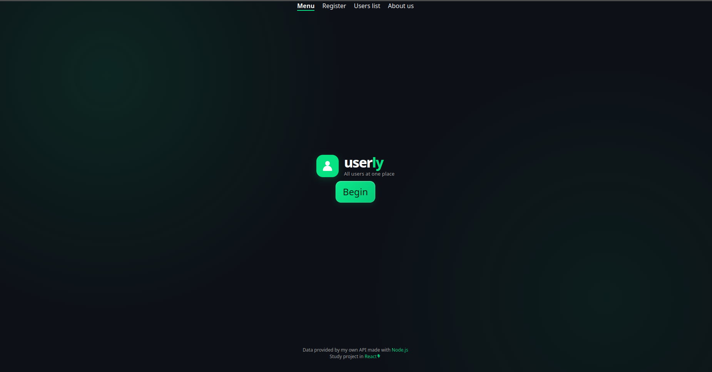
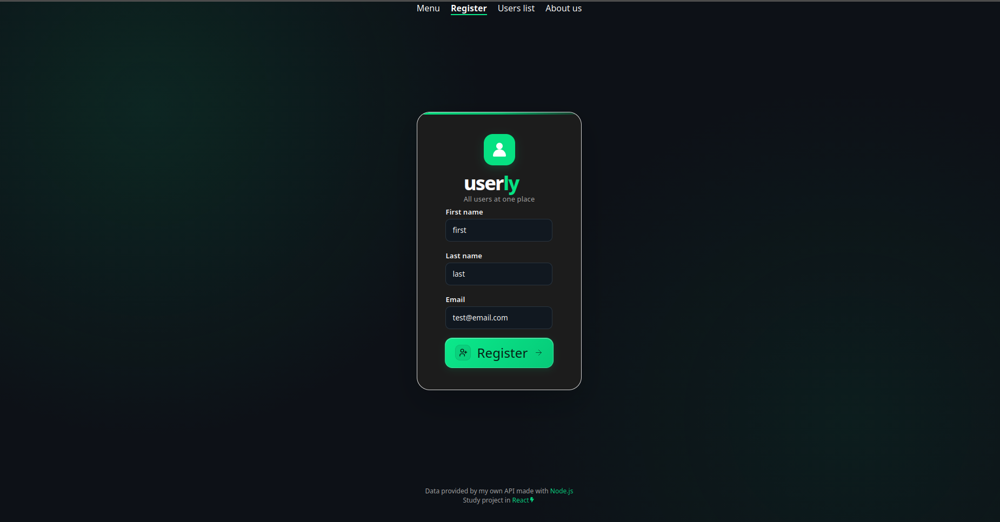
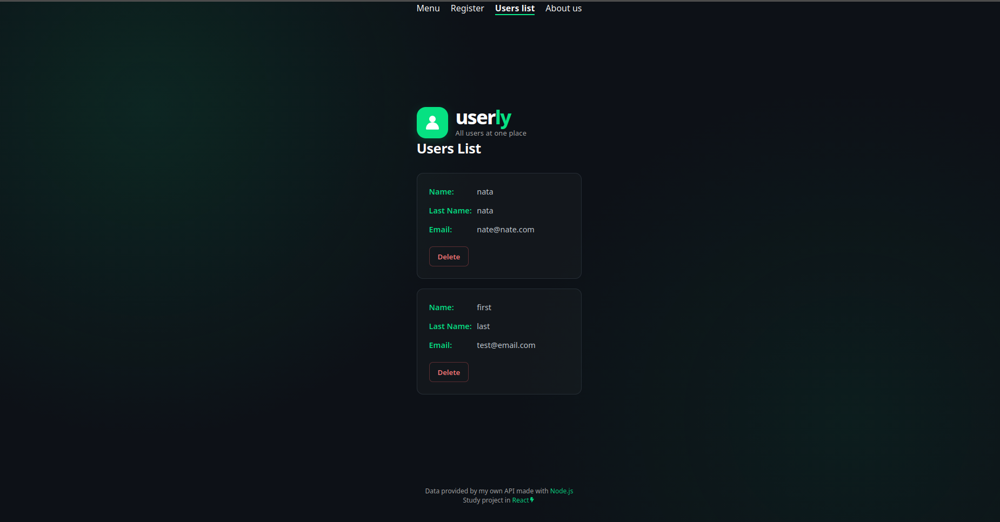
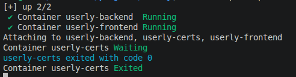

# Userly

> All users at one place.

Userly is a full-stack web application for registering, listing and removing users. It was built as a study project to practice the whole web development cycle: a React single-page app, a REST API in Node.js, a SQLite database and a containerized setup that runs everything with a single command.

<p align="center">
  
</p>

## Features

- Register users with first name, last name and email
- List all registered users
- Delete users (with confirmation)
- Server-side validation with clear error messages (invalid data, duplicated email)
- Case-insensitive unique emails enforced at the database level
- Client-side feedback for success and error states
- Fully containerized: one command brings up the database setup, the API and the frontend

## Screenshots

| Register | Users list |
| :---: | :---: |
|  |  |

## Tech stack

| Layer | Technologies |
| --- | --- |
| Frontend | React 19, React Router, styled-components, Vite, Oxlint |
| Backend | Node.js 24, Express 5, native `node:sqlite` |
| Database | SQLite |
| Infrastructure | Docker, Docker Compose, Nginx, OpenSSL |

## Getting started

### Run with Docker (recommended)

Requirements: [Docker](https://docs.docker.com/get-docker/) with Docker Compose.

```bash
git clone https://github.com/natapereirax-cmd/Userly.git
cd Userly
docker compose up --build
```

Then open **http://localhost:5173**.

On the first run, a one-shot container generates a self-signed TLS certificate for the API and exits. The database file is persisted in `backend/data/`, so your users survive restarts.

<p align="center">
  
</p>

To stop everything:

```bash
docker compose down
```

### Run locally (without Docker)

Requirements: Node.js 24+ and OpenSSL.

**1. Generate a local certificate** (the API runs over HTTPS):

```bash
mkdir -p backend/certs
openssl req -x509 -newkey rsa:2048 -nodes -days 365 \
  -keyout backend/certs/localhost-key.pem \
  -out backend/certs/localhost-cert.pem \
  -subj "/CN=localhost" \
  -addext "subjectAltName=DNS:localhost,IP:127.0.0.1"
```

**2. Start the backend:**

```bash
cd backend
npm install
npm run dev
```

**3. Start the frontend** (in another terminal):

```bash
cd frontend
npm install
npm run dev
```

The Vite dev server runs on **http://localhost:5173** and proxies `/api` requests to the backend at `https://localhost:3000`.

### Environment variables (backend)

| Variable | Default | Description |
| --- | --- | --- |
| `PORT` | `3000` | Port the API listens on |
| `DB_PATH` | `userly.db` | Path to the SQLite database file |
| `FRONTEND_URL` | `http://localhost:5173` | Origin allowed by CORS |

## API

Base path: `/api/users`

| Method | Endpoint | Description | Success | Errors |
| --- | --- | --- | --- | --- |
| `GET` | `/api/users` | List all users | `200` with an array of users | `500` |
| `POST` | `/api/users` | Create a user | `201` `{ "ok": true }` | `400` invalid data, `409` email already registered |
| `DELETE` | `/api/users/:id` | Delete a user by id | `204` no content | `400` invalid id, `404` user not found |

**Create user request body:**

```json
{
  "firstname": "Ada",
  "lastname": "Lovelace",
  "email": "ada@example.com"
}
```

Validation rules: all fields are required, names are limited to 100 characters, email to 254 characters and must have a valid format.

## Project structure

```
Userly/
├── docker-compose.yml
├── backend/
│   ├── Dockerfile
│   └── src/
│       ├── server.js          # HTTPS server bootstrap
│       ├── app.js             # Express app, CORS, error handler
│       ├── config/            # Database connection and schema
│       ├── routes/            # Route definitions
│       ├── controllers/       # Request validation and HTTP responses
│       └── services/          # Database queries
└── frontend/
    ├── Dockerfile
    ├── nginx.conf             # Static files + reverse proxy to the API
    └── src/
        ├── components/        # Reusable UI (button, header, footer, icon)
        └── containers/        # Pages (menu, register, list, about)
```

## Technical decisions

- **Layered backend (routes → controllers → services).** Routes only map URLs, controllers validate input and shape HTTP responses, and services talk to the database. Each layer can change without touching the others.
- **Parameterized queries.** All SQL uses prepared statements, which prevents SQL injection.
- **Uniqueness enforced by the database.** The `UNIQUE COLLATE NOCASE` constraint on `email` guarantees there are no duplicates even under concurrent requests. The API translates that constraint error into a `409 Conflict`.
- **HTTPS between services.** The API only serves HTTPS. A small init container generates a self-signed certificate into a shared volume, and the backend waits for it (`service_completed_successfully`) before starting. The certificate never enters the image or the repository.
- **Nginx as reverse proxy.** The frontend container serves the built static files and forwards `/api` to the backend over the internal Docker network, so the browser talks to a single origin (no CORS issues) and the API port is not exposed to the host.
- **Multi-stage frontend build.** Node builds the app, and only the static output is copied to a lightweight `nginx:alpine` image.
- **Secrets and data stay out of images.** `.gitignore` and `.dockerignore` exclude `.env`, certificates and database files. Data enters the container through a volume.

## Roadmap

- [ ] Edit existing users (`PUT /api/users/:id`)
- [ ] Automated tests for the API and a CI workflow
- [ ] Authentication
- [ ] Pagination and search on the users list

## About

This is a study project created to practice frontend design, backend development, database management and containerization.
